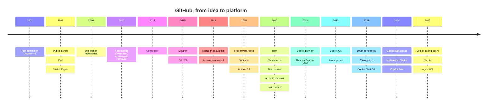

<div align="center">

# 📜 GitHub Chronicle

### The story of GitHub, from a weekend idea in 2007 to the home of over 150 million developers, kept up to date every single day.

[](https://github.com/pavitra-prabhakar/github-chronicle/actions/workflows/daily-chronicle.yml)
[](https://github.com/pavitra-prabhakar/github-chronicle/actions/workflows/validate.yml)
[](https://github.com/pavitra-prabhakar/github-chronicle/releases)
[](https://github.com/pavitra-prabhakar/github-chronicle/commits/main)
[](LICENSE)
[](CONTRIBUTING.md)

**[Timeline](#-the-timeline-2007--2025)** · **[Eras](timeline/)** · **[Daily log](daily/)** · **[Data](data/milestones.json)** · **[How it works](#%EF%B8%8F-how-it-works)** · **[Contribute](CONTRIBUTING.md)**

</div>

---

## 📖 Table of contents

- [Why this exists](#-why-this-exists)
- [GitHub at a glance](#-github-at-a-glance)
- [The timeline, 2007 to 2025](#-the-timeline-2007--2025)
- [Latest updates](#-latest-updates)
- [Explore by era](#-explore-by-era)
- [How it works](#%EF%B8%8F-how-it-works)
- [Use the data](#-use-the-data)
- [Contributing](#-contributing)
- [Sources](#-sources)
- [License and citation](#-license-and-citation)

## 💡 Why this exists

Almost every developer alive today has pushed code to GitHub, yet the story of how it became the center of open source is scattered across old blog posts, press releases and conference keynotes. **GitHub Chronicle** puts it in one place:

- 🗺️ **A readable, sourced timeline** of the milestones that shaped GitHub, from the first commit to AI coding agents.
- 🧾 **Machine-readable data** in [`data/milestones.json`](data/milestones.json), so you can build your own charts, bots and quizzes.
- 📰 **A living daily log** in [`daily/`](daily/): once a day, an automated pull request records what GitHub shipped (from the official [GitHub Changelog](https://github.blog/changelog/)) and what happened on this day in GitHub history.
- 📦 **Monthly releases** that bundle each month of the log into a tagged snapshot.

Every entry links to a primary or reputable source. No filler, no padding.

## 🧭 GitHub at a glance

| | |
|---|---|
| 🧑‍🤝‍🧑 **Founders** | Chris Wanstrath, PJ Hyett, Tom Preston-Werner and Scott Chacon |
| 🌱 **First commit** | October 19, 2007 |
| 🚀 **Public launch** | April 10, 2008 |
| 🏢 **Acquired by** | Microsoft (announced June 4, 2018, $7.5 billion in stock) |
| 👤 **CEOs** | Chris Wanstrath, Tom Preston-Werner, Chris Wanstrath, Nat Friedman, Thomas Dohmke |
| 🤖 **AI era** | GitHub Copilot preview (2021), GA (2022), coding agent (2025) |

## 🕰️ The timeline, 2007 to 2025



### 🌱 2007, the idea
- **October 19, 2007.** Chris Wanstrath makes the first commit to what would become GitHub, a side project started with Tom Preston-Werner after a Ruby meetup in San Francisco. PJ Hyett and Scott Chacon join as co-founders. The idea is simple: make Git, a powerful but intimidating tool, social and easy to share.

### 🚀 2008, launch
- **April 10.** After a private beta, GitHub officially launches. Profiles, forks and a visual network of collaborators make "social coding" real.
- **July 21.** **Gist** arrives: shareable snippets where every gist is a Git repo.
- **December 18.** **GitHub Pages** lets anyone publish a website straight from a repository, later powered by **Jekyll**.

### 📈 2009 to 2011, growing up
- GitHub stays **bootstrapped and profitable**, growing on paid private repositories.
- **July 2010.** The platform passes **one million repositories**.
- Forks and pull requests become the everyday way open source projects accept changes.

### 💰 2012, first outside funding
- **July 9.** GitHub takes its first outside investment: **$100 million led by Andreessen Horowitz**.

### 🧪 2013 to 2017, the hackable era
- **February 2014.** GitHub introduces **Atom**, "a hackable text editor for the 21st century", and open sources it that May.
- **January 2014.** Chris Wanstrath returns as CEO; Tom Preston-Werner, CEO since 2012, resigns from GitHub that April.
- **April 2015.** Atom's application shell is renamed **Electron**, which goes on to power apps like Visual Studio Code, Slack and Discord. **Git LFS** is announced the same month.
- GitHub ships the desktop client, Classroom, the Student Developer Pack and code review features that shape modern workflows.

### 🤝 2018, the Microsoft deal
- **June 4.** Microsoft announces it will acquire GitHub for **$7.5 billion in stock**.
- **October.** At Universe, **GitHub Actions** is unveiled in beta.
- **October 26.** The deal closes and **Nat Friedman** becomes CEO.

### 🆓 2019, GitHub for everyone
- **January 7.** **Unlimited free private repositories** for individuals.
- **May 23.** **GitHub Sponsors** launches to fund open source developers.
- **November 13.** At Universe, **GitHub Actions** (with built-in CI/CD) and **Packages** become generally available; the **GitHub Archive Program** is announced.

### 🌍 2020, a platform for every team
- **March 16.** **npm** joins GitHub.
- **April 14.** GitHub becomes **free for teams**, with unlimited private repos and collaborators.
- **May 6.** At the first virtual Satellite: **Codespaces**, **Discussions**, and code and secret scanning.
- **July.** The **Arctic Code Vault** deposits a February 2 snapshot of public code in the Arctic World Archive in Svalbard, built to last 1,000 years.
- **September 17.** **GitHub CLI 1.0** brings `gh` to the terminal.
- **October 1.** New repositories default to the **`main`** branch.

### 🤖 2021, the AI pair programmer
- **June 29.** **GitHub Copilot** launches as a technical preview, built with OpenAI.
- **November 15.** **Thomas Dohmke** succeeds Nat Friedman as CEO.

### ✨ 2022, Copilot for everyone
- **June 21.** **Copilot becomes generally available**, free for verified students and popular open source maintainers.
- **December 15.** **Atom is sunset** and archived, as announced in June. Electron lives on.

### 🔐 2023, scale and security
- **January 25.** GitHub passes **100 million developers**.
- **March 13.** **Two-factor authentication** becomes mandatory for code contributors, rolled out in waves.
- **December 29.** **Copilot Chat** is generally available in all Copilot plans.

### 🧠 2024, more choice
- **April 29.** **Copilot Workspace** previews an issue-to-plan-to-code workflow.
- **October 29.** At Universe, **Copilot goes multi-model** with models from Anthropic, Google and OpenAI.
- **December 18.** **Copilot Free** launches in VS Code, and GitHub passes **150 million developers**.

### 🛰️ 2025, the agent era
- **May 19.** The **Copilot coding agent**: assign an issue to Copilot and it opens a pull request.
- **August 11.** Thomas Dohmke announces he will step down; GitHub continues as part of Microsoft's **CoreAI** organization.
- **October 28.** At Universe, **Agent HQ** brings coding agents from multiple providers into GitHub.

### 📅 2026 and beyond
The story is still being written, one day at a time, in [`daily/`](daily/).

## 📰 Latest updates

<!-- LATEST:START -->
_The first daily entry will appear here after the Daily Chronicle workflow runs._
<!-- LATEST:END -->

## 🗂️ Explore by era

| Era | Years | Highlights |
|---|---|---|
| [🌱 Origins](timeline/2007-2011-origins.md) | 2007 to 2011 | First commit, launch, Gist, Pages, one million repos |
| [📈 Growth](timeline/2012-2017-growth.md) | 2012 to 2017 | a16z funding, Atom, Electron, Git LFS |
| [🤝 Microsoft](timeline/2018-2020-microsoft-era.md) | 2018 to 2020 | Acquisition, Actions, free private repos, npm, Codespaces |
| [🤖 AI](timeline/2021-2025-ai-era.md) | 2021 to 2025 | Copilot, Copilot Chat, coding agent, Agent HQ |

## ⚙️ How it works

```text
 ┌─────────────── every day at 03:17 UTC ───────────────┐
 │  .github/workflows/daily-chronicle.yml               │
 │    1. branch daily/YYYY-MM-DD from main              │
 │    2. python scripts/daily.py                        │
 │         • reads the GitHub Changelog RSS feed        │
 │         • adds "On this day in GitHub history"       │
 │         • falls back to a milestone deep-dive        │
 │         • refreshes "Latest updates" above           │
 │    3. one commit → one pull request → squash merge   │
 │    4. branch deleted, dev fast-forwarded to main     │
 └──────────────────────────────────────────────────────┘
 ┌──────────── 1st of every month ────────────┐
 │  monthly-release.yml → release vYYYY.MM    │
 └────────────────────────────────────────────┘
```

- **One real change per day.** Every daily file contains real content: new GitHub Changelog entries with links, or a sourced deep-dive into a milestone. If a file for the day already exists, nothing is committed.
- **Branches.** Only `main` (published) and `dev` (for contributions) live long term. Daily `daily/*` branches are deleted when their PR merges.
- **Built-in end date.** The automation stops itself five years after setup (see `.github/chronicle.json`). Nothing runs forever by accident.
- **Stays awake.** GitHub disables scheduled workflows in public repos after 60 days without repository activity. The daily merge is itself activity, so the schedule keeps running; if it is ever disabled, re-enable it from the Actions tab.
- **Standard library only.** `scripts/daily.py` uses nothing outside Python's standard library.

Run it yourself: **Actions → Daily Chronicle → Run workflow**, or locally with `python scripts/daily.py --dry-run`.

## 🧾 Use the data

```python
import json, urllib.request
url = "https://raw.githubusercontent.com/pavitra-prabhakar/github-chronicle/main/data/milestones.json"
data = json.load(urllib.request.urlopen(url))
for m in data["milestones"]:
    print(m["year"], m["title"])
```

Every milestone has `id`, `year`, `month`, `day` (null when not well established), `era`, `category`, `title`, `summary` and `source`.

## 🤝 Contributing

Found a milestone we missed, or a date that needs a better source? Open a [milestone suggestion](../../issues/new/choose) or read [CONTRIBUTING.md](CONTRIBUTING.md). Please branch from `dev`.

## 📚 Sources

- [GitHub Blog](https://github.blog/) and [GitHub Changelog](https://github.blog/changelog/)
- Tom Preston-Werner, [How I Turned Down $300,000 from Microsoft to go Full-Time on GitHub](https://tom.preston-werner.com/2008/10/18/how-i-turned-down-300k) (2008)
- [Investing in GitHub](https://github.blog/news-insights/investing-in-github/) (2012)
- Microsoft, [Microsoft to acquire GitHub for $7.5 billion](https://news.microsoft.com/2018/06/04/microsoft-to-acquire-github-for-7-5-billion/) (2018)
- [New Year, new GitHub](https://github.blog/news-insights/product-news/new-year-new-github/) (2019)
- [New from Universe 2019](https://github.blog/news-insights/product-news/universe-day-one/) (2019)
- [New from Satellite 2020](https://github.blog/news-insights/company-news/new-from-satellite-2020-github-codespaces-github-discussions-securing-code-in-private-repositories-and-more/) (2020)
- [GitHub Archive Program, Arctic Code Vault](https://archiveprogram.github.com/arctic-vault/)
- [Introducing GitHub Copilot](https://github.blog/news-insights/product-news/introducing-github-copilot-ai-pair-programmer/) (2021)
- [Sunsetting Atom](https://github.blog/news-insights/product-news/sunsetting-atom/) (2022)
- [100 million developers and counting](https://github.blog/news-insights/company-news/100-million-developers-and-counting/) (2023)
- [Auf Wiedersehen, GitHub](https://github.blog/news-insights/company-news/goodbye-github/) (2025)
- [Introducing Agent HQ](https://github.blog/news-insights/company-news/welcome-home-agents/) (2025)
- Wikipedia, [Timeline of GitHub](https://en.wikipedia.org/wiki/Timeline_of_GitHub)

Every milestone in [`data/milestones.json`](data/milestones.json) carries its own source link.

## 📄 License and citation

Released under the [MIT License](LICENSE). If you use this data, please cite it using [CITATION.cff](CITATION.cff).

<div align="center">

Made with ❤️ by **पवित्र प्रभाकर** · If this helped you, consider giving it a ⭐

</div>
